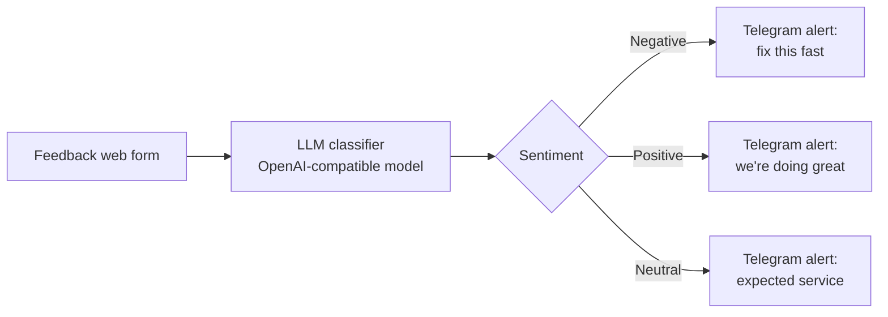

# Customer Feedback Sentiment Analysis

A small **n8n** automation. A customer fills in a web form, an LLM classifies the feedback as **Positive**, **Negative** or **Neutral**, and a matching alert goes to Telegram so the team can react quickly.

## How it works



1. **Feedback Form** collects one text field.
2. **Classify Sentiment** sends the text to the model together with a structured output schema.
3. **Sentiment Output Schema** forces the answer to be exactly `Positive`, `Negative` or `Neutral`. This keeps the routing reliable, because the Switch node compares the value as an exact string.
4. **Route by Sentiment** sends the item to one of three Telegram messages that include the customer's original text.

## Example

| Feedback | Result |
|---|---|
| "The food was cold and the waiter was rude." | Negative alert |
| "Best burger in town, thank you!" | Positive alert |
| "It was okay, nothing special." | Neutral alert |

## Tech stack

| Part | Tool |
|---|---|
| Automation | n8n (form trigger, LLM chain, Switch) |
| Language model | n8n OpenAI Chat Model node (OpenAI or any OpenAI-compatible provider) |
| Notifications | Telegram Bot API |

## Setup

1. **Telegram bot.** Talk to [@BotFather](https://t.me/BotFather), create a bot and keep the token. Send your bot a message, then find your chat ID (for example with [@userinfobot](https://t.me/userinfobot)).
2. **Language model.** Create an API key with OpenAI or another OpenAI-compatible provider. For a provider other than OpenAI, set its Base URL in the n8n credential and enter a model name it supports in the model node (the file uses `gpt-4o-mini` as a default).
3. **Import the workflow.** In n8n choose Workflows, then Import from file, and pick `workflows/feedback-sentiment-analysis.json`.
4. **Create credentials in n8n:** Telegram and OpenAI. Credentials stay inside n8n and are not part of the exported file.
5. **Replace the placeholder** `YOUR_TELEGRAM_CHAT_ID` in the three `Notify` nodes.
6. Activate the workflow, open the form's production URL and submit some feedback.

## Troubleshooting

**Error: "The resource you are requesting could not be found. The Responses API (/v1/responses) is not available."**
Some OpenAI-compatible providers only support the older chat completions format. Open the **OpenAI Chat Model** node and switch **Use Responses API** off. The workflow file already has it off.

## Next steps

- Store every feedback entry and its label in Google Sheets for reporting.
- Add a confidence value or a short summary to the alert.
- Handle unexpected model output with a fallback branch.

## Repository structure

```
workflows/
  feedback-sentiment-analysis.json
```

## Author

Ahmed Abdelazeem Mohamed ([GitHub](https://github.com/Ahmed-Abdelazeem-466))
